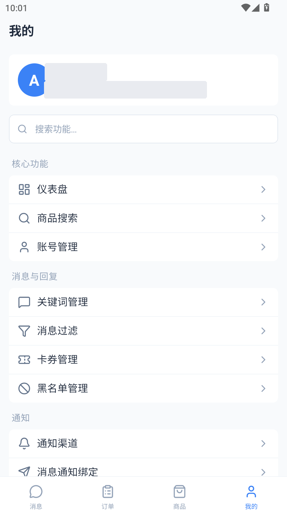

# 闲鱼自动回复系统

基于 FastAPI + React + MySQL + Redis + Playwright 的闲鱼多账号自动化系统。

主系统负责账号管理、消息收发、自动回复、自动发货、商品发布与后台管理；`promotion` 子项目负责返佣账号、选品规则、素材库、发布规则、删除规则和相关修复任务。

## 🔴 说明

> **🔴 诚邀各位开发者提交pr，完善系统**
>
> **🔴 承接各类项目定制，各类项目均可，有需要可联系，另外我菜，不一定都会**

## 🔴 最新源码地址(建议转存)

> 🔴 我用夸克网盘给你分享了「自动发货」，点击链接或复制整段内容，打开「夸克网盘APP」即可获取。
> 
> 🔴 /~79313YhCQU~:/
> 
> 🔴 **链接：https://pan.quark.cn/s/af567356cba7**

## 交流群

| 微信群 | QQ群 | 微信公众号 | Telegram | 赞赏支持 |
|:---:|:---:|:---:|:---:|:---:|
|  |  |  |  |  |
| 扫码加好友拉微信交流群 | 扫码加入QQ交流群 | 关注公众号发送"最新源码"获取最新代码 | 扫码加入Telegram群 | 如果觉得好用，请作者喝杯咖啡 |

如群二维码过期，请关注公众号获取最新群链接。

---

## 功能概览

### 主系统

| 模块 | 说明 |
|------|------|
| 多账号管理 | 支持多个闲鱼账号登录、状态切换、Cookie 维护与登录续期 |
| 自动回复 | 支持文本关键词、图片关键词、默认回复、商品专属回复；API关键词支持GET/POST回复及同步确认发货 |
| AI 回复 | 支持大模型上下文对话与智能回复 |
| 自动发货 | 支持卡券、虚拟商品、自动补发、发送结果记录 |
| 在线聊天 | 支持会话列表、消息收发、聊天联动 |
| 商品发布 | 支持素材库、地址库、单品发布、批量发布、发布日志 |
| 订单与评价 | 订单拉取、自动评价、求小红花、状态跟踪 |
| 商品采集与分销 | Goofish 采集、货源管理、对接记录、结算链路 |
| 通知与风控 | 支持消息通知、风控日志、系统反馈与公告管理 |

用户管理表格新增「结算记录」列。管理员点击后按选中用户分页查看提现金额、收款方式、结算结果、拒绝原因、备注及北京时间，可逐条修改为待审核、已通过、已拒绝或已打款；拒绝时必须填写原因。保存使用记录版本和行锁校验并发，历史备注保留，并追加管理员编号、时间和修改说明。修改结果不触发自动付款、扣款或退款；「已打款」需与实际付款一致。普通用户仍只能查看自己的记录，移动端接口保持兼容。部署需同步网页前端、`backend-web` 与 `common`，服务启动会幂等补齐 `settlement_status` 和 `settlement_payment_type` 字典，不改变历史记录。

自动回复页面选择具体账号后，点击「新增 API关键词」填写触发关键字、API地址、GET/POST请求方法、超时时间、JSON请求头与参数、响应取值字段，以及同步确认发货、下单后触发、跟随订单数量触发和相同消息不触发开关。关键字支持中英文逗号分隔；GET/POST请求参数均支持 `{item_id}`（商品ID）和 `{message}`（完整消息内容），GET中的嵌套对象及数组以JSON查询参数发送。命中后按API卡券相同规则取值并以文本返回，支持纯文本、JSON对象、数组及字段路径。不填写取值字段时优先取 `data`、`content`、`card`，否则返回整个响应。商品专属关键词优先；通用关键词同范围按图片、站外联系方式、API、文本排序。

「下单后触发」开启时，精确核对账号所属用户、买家和商品的最新有效订单，待发货、已发货、已完成均满足触发资格；未付款、退款或关闭的订单不满足资格，无有效订单不会调用API。关闭时直接调用API。「同步确认发货」开启时，待发货订单在结果发送且通过现有消息拦截检测后确认发货，小刀订单先免拼再确认；该规则的显式开关优先于账号的只发卡券/同意后发货模式，保留原禁止发货规则检查。下单资格检查命中的订单已发货或已完成时，仍返回本次API结果，跳过重复免拼与确认发货，并保留原发货内容；此前API结果已完整发送但正式发货内容尚未落库的订单仍沿用原恢复流程。未限制下单且无待发货订单时仍返回API结果，跳过确认并记录原因。API失败、响应为空、消息发送失败或订单状态变化时停止确认，并在自动回复日志记录具体原因。订单锁与自动发货共用并定期续期；HTTP请求不自动重试，避免第三方重复处理。独立表 `xy_api_keyword_rules` 及对应中文字典由 `common/db/init_database.py` 统一自检补齐，原普通关键词保存不会覆盖API配置。

两个开关均开启且订单仍待发货时，先执行禁止发货检查，再取API结果；完整结果和发送检测进度保存在订单元数据中，并设置已处理标记，避免普通或定时自动发货再次取卡。使用 `######` 分段时逐段检测和保存进度，发送失败或人工暂停后，只补发未完成分段；全部发送完成后确认失败，则只重试确认。处理中不写正式发货内容，确认成功后才写入，避免自动续售提前触发。待发货订单已有其他发货流程标记或发货内容时会明确拒绝混用。等待回执或免拼期间人工暂停会停止后续确认；订单退款或关闭也会停止。下单限制关闭时，每次触发仍正常请求API，不按订单复用结果。

历史API配置表缺少 `request_id` 时，自检以可空字段补齐并创建唯一索引，兼容多条旧记录；所有新建保存仍必须提供请求标识，支持幂等重试，不修改历史配置。

请求参数支持选择 `actId`，点击后添加 `{"actId": "{actId}"}`，GET和POST请求均提取消息中的第一个HTTP/HTTPS链接作为值；没有链接时传递完整消息。`message` 始终传递完整消息。例如 `58￥ HU287 mc9v6Ygkg2j￥ https://m.tb.cn/h.jhsaw8X  助我领红包` 的 `actId` 为 `https://m.tb.cn/h.jhsaw8X`。历史 `{"actId": "{message}"}` 配置自动兼容相同提取规则，无需修改历史配置；手动填写的actId常量保持原值。参数选项由数据库字典提供，`init_database.py` 自检会补齐字典并更新原默认文案，保留自定义名称及启用状态。

GET会保留API地址已有查询串的编码和顺序，使用 `&` 追加新参数；地址中已有同名参数时，由配置的请求参数覆盖，避免重复。其他原有参数（包括重复参数及无值参数）保持原样。POST保留地址中的查询串，配置参数通过JSON请求体发送。

API关键词列表的「编辑」可修改触发关键字、API地址、GET/POST方法、超时、请求头、参数、取值字段及四个开关。打开时读取最新配置，保存后刷新当前页；账号及所属用户保持原归属，后端复用新建校验并阻止旧窗口覆盖已变化的配置。后续消息使用新配置，正在处理的消息保留本次配置快照；已有订单恢复记录不会混用修改后的API请求配置。

API关键词与文本关键词共用商品选择组件：新建通过搜索框筛选当前账号商品，可勾选多个商品或全选，商品列表内部滚动；编辑使用单选下拉框，支持切换为通用关键词。每个选中商品分别创建一条配置，全部配置在同一事务中保存，失败不会部分落库，相同请求可安全重试。未选择商品时创建通用关键词。列表及详情展示商品范围。自动回复先匹配当前商品的专属关键词，无匹配才查通用关键词，其他商品的专属配置不会触发；同一范围保留图片、站外联系方式、API、文本的优先级。后端校验新绑定商品属于配置账号及所属用户。

本次表结构变更新增 `xy_api_keyword_rules.item_id`（绑定商品ID，`VARCHAR(64) NULL`），由 `common/db/api_keyword_schema.py` 在启动自检时幂等补齐，历史记录空值继续作为通用关键词，不修改历史配置数据。更新需同步网页前端、`backend-web`、`common` 和WebSocket服务，并先完成数据库初始化。移动端文件保持原样；现有单条新建接口仍允许省略商品ID，编辑接口需提交商品ID以避免误清空已有绑定。

API关键词新增「跟随订单数量触发」和「相同消息不触发」，新建、编辑与配置详情均支持保存及回显，默认关闭。相同消息限制查询 `xy_auto_reply_message_logs`：同用户、闲鱼账号、买家和商品已有完整消息相同且处理成功的记录时跳过，失败及发送失败的记录不拦截；比较区分大小写与首尾空格。订单数量限制取同买家同商品最新一笔有效订单的购买数量，按实际命中的单个关键词统计该订单下单后处理成功的消息条数；数量为2时最多成功处理2条，第3条跳过，无有效订单或缺少商品也不触发。有效订单包含待发货、已发货与已完成，排除未付款、退款和关闭订单。通用API关键词同样按本次对话商品核对订单；先匹配商品专属关键词，未匹配到才使用通用关键词。

两项限制均在调用API前检查，开启时使用买家与商品范围的Redis锁，持有到最终日志提交以避免并发超额，第三方请求期间自动续期；被限制的消息记录为跳过，不调用API或执行同步发货。数据库新增 `xy_api_keyword_rules.follow_order_quantity`（是否跟随订单数量限制触发次数）和 `skip_same_message`（是否跳过已处理成功的相同消息），均为默认0的布尔字段；启动自检幂等补齐字段及 `api_keyword_trigger_reason` 中文字典，不改写历史配置或成功日志。

最新订单优先按真实下单时间排序，无下单时间时使用入库时间，避免补录历史订单改变当前额度。开启任一触发限制时，普通API回复先完成发送检测再记录成功；分段发送及免拼、确认发货前检查触发锁。成功消息日志写入失败时，将真实日志暂存统一Redis，后续消息先幂等补记再查询触发次数；恢复仍失败则停止新API请求。补记保留首次记录时间，不将旧消息计入后来新订单。

API关键词列表支持逐条「删除」，确认后按原账号和所属用户权限软删除（`is_deleted`），保留原配置和已有订单记录。删除成功后刷新当前页，删除期间切换页面再返回也会同步刷新，当前页已无记录时自动退回有效页；后续消息不再匹配该规则，已开始处理的消息继续使用本次配置快照。重复删除同一记录返回成功，已删除配置不能再编辑；无需新增数据库字段。

批量保存新增 `xy_api_keyword_rules.request_item_scope`（首次保存的商品范围摘要，`VARCHAR(64) NULL`），启动自检幂等补齐，历史记录保持空值。首次保存记录完整商品范围，响应丢失后使用相同请求标识更改商品选择会明确拒绝，避免部分结果掩盖此前已创建的配置。API回复成功后，通知异常保留成功日志并记录异常上下文；未完成的API任务取消后记录失败并清除消息占用，允许再次触发。

删除后刷新遇到列表数据格式异常时会明确提示，支持点击「刷新」重试。登录过期触发的刷新令牌请求也使用统一的90秒超时，失败时释放并发等待请求，避免删除一直停留在加载状态。

修改接口必须提交全部配置字段及读取时的版本，漏传字段会明确拒绝，避免默认值清空请求头、参数或关闭开关。原请求方法已禁用时，编辑窗口仍回显原配置，需手动选择启用的方法后保存。相同新建标识的重试按JSON内容和类型校验，数字 `0` 与布尔值 `false` 不会被当成同一配置。

API关键词的禁止发货检查采用严格模式：账号或规则读取失败、规则查询异常、信用度接口检查失败及未知规则编码均明确停止同步发货。免拼期间同步为已发货/已完成的原订单仍由确认接口核实平台结果，退款或关闭状态不放行。两个开关均开启时，若结果已完整发送且平台已发货，但本地正式内容保存失败，重试可复用原记录核实并补齐内容，不再次请求API或发送结果。

更新部署时，先更新网页后端并确认数据库初始化成功，再更新WebSocket服务。发送检测沿用现有自动发货规则：未收到明确回执的超时按未发现拦截处理；第三方API完成操作后、结果落库前若进程异常退出，需核对第三方记录，无法仅靠本地订单锁保证外部操作绝对只执行一次。

### 返佣子系统

| 模块 | 说明 |
|------|------|
| 返佣账号 | 返佣账号登录、状态管理、Cookie 维护 |
| 选品规则 | 按规则抓取候选商品并自动写入素材库 |
| 素材库 | 管理标题、图片、详情、淘口令、短链、库存、发布状态 |
| 发布规则 | 定时发布返佣商品，复用公共发布能力 |
| 删除规则 | 定时删除已发布商品 |
| 补偿任务 | 已发布商品 ID 回写、短链修复、卡券补偿等 |

## 技术栈

### 后端与自动化

| 技术 | 说明 |
|------|------|
| FastAPI | 主系统与返佣后端 API 服务 |
| SQLAlchemy 2.0 | ORM 与数据库访问 |
| MySQL 8.0 | 主数据存储 |
| Redis 7 | 缓存、会话与任务辅助 |
| Playwright | 登录、Cookie 刷新、发布等浏览器自动化 |
| APScheduler | 定时任务调度 |
| Loguru | 日志管理 |

### 前端

| 技术 | 说明 |
|------|------|
| React 18 + TypeScript | 主系统与返佣前端 |
| Vite | 开发与构建 |
| TailwindCSS | 主系统 UI 样式 |
| Zustand | 状态管理 |
| Lucide React | 图标体系 |

### 部署

| 技术 | 说明 |
|------|------|
| Docker / Docker Compose | 容器化部署 |
| Nginx | 前端静态资源与反向代理 |

## 商品查询性能与更新

商品管理与卡券关联商品查询采用独立优化链路：商品管理每页只执行精确计数和本页商品/配置状态两次 SQL，保持 ID、标题、详情搜索及原接口字段；关联弹窗使用轻量分页接口 `/api/v1/items/selectable/paginated`，只返回 ID、标题和价格，点击「查询」或回车后筛选名称/ID。全选与分页使用相同筛选条件，跨账号重复商品合并展示，旧请求不会覆盖新查询结果。

部署本次更新需要同时更新网页前端与 backend-web。索引实现位于 `common/db/item_query_indexes.py`，统一由 `common/db/init_database.py` 的 `init_all()` 在现有数据库自检锁内调用；backend-web 启动和单独执行统一初始化入口都会幂等补齐商品索引 `idx_cat_created_id(created_at, id)`、`idx_cat_account_created_id(account_id, created_at, id)`，并检查普通用户排序索引 `idx_cat_owner_created(owner_id, created_at)` 和完整的 `item_id` 索引。检查时排除截断索引、不可见索引及不能支持当前排序的索引。只增加缺失索引，不改写商品数据。首次在大表创建索引可能延长启动时间，失败会在初始化日志中明确显示。查询日志记录总数、返回数及耗时，方便核对生产效果。原 `/items/paginated` 字段格式与移动端兼容，移动端目录无需更新。

普通 B-tree 索引无法直接加速任意 `%关键词%` 包含搜索；商品管理保留详情搜索，因此大范围详情关键词查询仍与匹配范围有关。

商品查询的启动补索引将缺失索引合并为一次 `ALTER TABLE ... ALGORITHM=INPLACE, LOCK=NONE`，减少大表重复扫描，数据库不支持时明确报错，不自动降级到 COPY 或锁表算法。启动日志在执行前打印索引名称，完成后打印耗时。`lock_wait_timeout` 仅限制元数据锁等待，不限制实际索引构建时间；在线构建仍消耗磁盘和 CPU，开始及结束需要短暂元数据锁，应在低峰期安排执行，运行期间避免重复执行及并发启动初始化。

排查卡住时在另一数据库连接执行 `SHOW FULL PROCESSLIST`、`SHOW INDEX FROM xy_catalog_items`，并结合 `information_schema.INNODB_TRX` 检查未提交长事务（需要 `PROCESS` 权限，权限不足时由 DBA 执行）。`Waiting for table metadata lock` 表示等锁，SELECT 的 `Creating sort index` 表示查询排序；`Sleep` 本身不代表锁持有者。先取消不需要的等待 DDL，再核对具体阻塞事务，禁止批量终止空闲连接或删除数据。

## 系统要求

### 开发环境

- Python 3.11+
- Node.js 18+
- MySQL 8.0+
- Redis 6+
- Chromium / Chrome（Playwright 相关功能）

### 生产环境

- Docker 20.10+
- Docker Compose 2.0+
- 最低 2 核 CPU / 4GB 内存
- 推荐 4 核 CPU / 8GB 内存

## 项目结构

```text
xianyu-auto-reply/
├── backend-web/          # 主 Web API 服务（端口 8089）
├── websocket/            # 闲鱼连接与消息处理服务（端口 8090）
├── scheduler/            # 定时任务服务（端口 8091）
├── common/               # 主系统与返佣系统共享模块
├── frontend/             # 主系统前端（端口 9000）
├── launcher/             # Windows 桌面启动器（Nuitka 打包为 EXE）
├── promotion/
│   ├── backend/          # 返佣后端（端口 8092）
│   └── frontend/         # 返佣前端（端口 9001）
├── scripts/              # CI/CD 与工具脚本
├── docker/frontend/      # 前端 Dockerfile 与 Nginx 配置
├── docker-compose.yml    # 本地源码构建编排
├── deploy.sh             # 一键部署脚本（自动生成远程镜像版 compose）
├── deploy_remote.sh      # 远程 MySQL/Redis 一键部署脚本（自动生成 docker-compose.remote.yml）
├── update.sh             # 一键更新脚本（拉取最新远程镜像）
├── build.sh              # 本地源码全量构建脚本
├── build_frontend.sh     # 单独构建并重启 Frontend
├── build_backend_web.sh  # 单独构建并重启 Backend-Web
├── build_websocket.sh    # 单独构建并重启 WebSocket
├── build_scheduler.sh    # 单独构建并重启 Scheduler
├── EXE打包构建.bat       # Windows 桌面启动器打包脚本
├── 离线依赖打包.bat      # Windows 离线依赖打包脚本
└── README.md
```

### 服务职责

| 服务 | 默认端口 | 说明 |
|------|----------|------|
| `frontend` | 9000 | 主系统前端 |
| `backend-web` | 8089 | 主系统 API 网关、业务接口 |
| `websocket` | 8090 | 闲鱼 WebSocket、消息收发、登录与订单联动 |
| `scheduler` | 8091 | 定时任务执行器 |
| `promotion/backend` | 8092 | 返佣后端 API |
| `promotion/frontend` | 9001 | 返佣前端 |

### 架构说明

- 主系统采用多服务拆分：
  - `frontend` 负责界面与交互
  - `backend-web` 负责大部分业务 API
  - `websocket` 负责闲鱼实时连接、扫码登录、消息处理
  - `scheduler` 负责自动发货、评价、订单拉取、Cookie 刷新等定时任务
  - `common` 提供模型、数据库、自检、公共服务与工具
- 返佣子系统位于 `promotion/` 目录，前后端独立，当前不在根目录 Docker Compose 编排内
- 主系统三个后端服务都提供 `/health` 健康检查接口
- WebSocket 在数据库、Redis 和服务配置检查完成后即可提供 HTTP 服务，账号配置加载与连接任务调度在后台错峰执行，不再因账号数量增加而推迟 HTTP 就绪。系统设置通过 `/health/ping` 检测消息服务存活，并显示账号启动进度或失败原因；调度完成不代表所有账号已连接，实际连接状态以账号管理为准。关闭服务时会先取消未完成的账号调度，再清理账号任务。
- Docker 依赖链：mysql/redis → backend-web → websocket → scheduler；frontend → backend-web

## 快速开始

### 方式一：服务器一键部署（推荐）

在 Linux 服务器上执行一键部署脚本即可；脚本开始时会打印检测到的系统名称、完整版本号、发行版标识和 CPU 架构，再检查 Docker 和 Compose，缺失时自动安装（需要 root 或免密 sudo）：

```bash
curl -fsSL https://xy-update.zhinianboke.com/deploy.sh | sed 's/\r$//' | bash
```

该脚本会自动完成环境准备、配置生成、镜像拉取、旧容器清理与服务启动。安装方式采用 `http://selfdownload.zhinianboke.com/shell/build-env1.sh`：Debian/Ubuntu 安装前先执行 `apt-get -o APT::Update::Error-Mode=any update` 刷新软件包索引，成功后执行 `apt install -y docker.io`，任一软件源更新失败则显示错误并停止；CentOS 执行 `yum install -y yum-utils device-mapper-persistent-data lvm2`，通过 `yum-config-manager --add-repo http://mirrors.aliyun.com/docker-ce/linux/centos/docker-ce.repo` 添加源，再安装 `docker-ce docker-ce-cli containerd.io`。首次安装且 `/etc/docker/daemon.json` 不存在时，从 `https://selfdownload.zhinianboke.com/file/website/docker/daemon.json` 下载配置并重启 Docker；已有配置保留。已有可用的 `docker compose` 或 `docker-compose` 直接复用；缺失时从 `http://selfdownload.zhinianboke.com/file/website/docker/docker-compose` 下载独立命令，安装到 `/usr/local/bin/docker-compose` 并建立 `/usr/bin/docker-compose` 软链接，再验证能否运行。部署脚本内文件下载统一使用 `curl -fsSL`，支持重定向、失败重试及连接/下载超时，HTTP 错误会停止安装，不再依赖 wget。curl 并非所有系统都预装，缺少时自动安装，Debian/Ubuntu 同样先刷新索引，同次部署只刷新一次。整个过程无需交互确认，安装或运行失败会显示错误并停止。

`deploy.sh` 为单文件脚本，包含环境安装、`.env` 和 Compose 配置生成及部署流程，无需配套脚本。原有 `.env` 保留，首次运行自动生成默认配置。

仅在检测到 Docker 未安装时，`deploy.sh` 才自动切换 Debian / Ubuntu / CentOS 软件源。Debian 不限定版本号，逐个检查现有源的版本代号和仓库：正常源存在时使用清华镜像，否则检查阿里云 `debian-archive` 归档镜像。主仓库或安全仓库均不存在、网络检查失败时明确报错并停止；正常源和归档源都不存在的 `-updates`、`-proposed-updates`、`-backports`、`-backports-sloppy` 附加仓库会提示并停用，避免 APT 更新出现 404。全部检查通过后先备份整个 `/etc/apt` 到 `/etc/apt.backup.时间戳.进程号`，再改写配置并执行 APT 索引更新。兼容 `sources.list`、`sources.list.d/*.list`、`.sources` 格式及 `mirror+file` 源；同一文件、同一 `.sources` 段内的多个版本与仓库会分别处理，保留发行版代号、仓库组件、签名和第三方源。归档条目单独关闭 `Check-Valid-Until` 有效期检查，保留签名验证；正常源不关闭有效期检查。旧系统缺少 `/etc/os-release` 或 `apt` 时分别兼容 `/etc/debian_version` 和 `apt-get`。换源兼容不代表任意旧系统都能运行当前 Docker：极旧版本可能没有 `docker.io`、内核或签名密钥不满足要求，脚本会显示实际失败原因，不擅自升级系统或跳过签名验证。

Ubuntu 不限定版本号，按现有源的发行版代号逐个验证仓库：amd64/i386 使用清华 `ubuntu`，ARM 等其他架构使用清华 `ubuntu-ports`；正常仓库不存在时检查中科大 `ubuntu-old-releases/ubuntu` 归档源。校验 Release 的 Origin、Suite 和架构，主仓库或安全仓库不存在、网络或内容异常时明确报错；两类源均不存在的 updates/backports/proposed 附加仓库会提示并停用。兼容传统 `.list`、Ubuntu 24.04 起使用的 `.sources`、多 URI/suite、区域官方源和 mirror 源；保留签名、第三方源及已停用条目，仅为 Ubuntu 官方源补齐安装 `docker.io` 所需的 universe 组件。所有仓库验证及配置生成成功后，先备份完整 `/etc/apt`，再写入并执行 APT 更新，归档条目单独关闭有效期检查而保留签名验证。旧 Ubuntu 缺少 os-release 时兼容 lsb-release。不升级发行版；极旧系统、仓库未提供 docker.io 或内核不兼容时仍会显示实际安装错误，不能保证全部历史版本完成 Docker 部署。

CentOS Linux 7/8 按对应版本下载 `http://mirrors.aliyun.com/repo/Centos-7.repo` / `http://mirrors.aliyun.com/repo/Centos-8.repo`，先备份 `/etc/yum.repos.d`，再将旧 `CentOS-*.repo` 文件改为带备份后缀的文件，写入阿里云配置并依次执行 `yum clean all`、`yum makecache`、`yum update -y`，之后安装 Docker。CentOS 7 写入 `CentOS-Base.repo`；CentOS Linux 8 按参考代码分别下载并写入 `CentOS-Linux-BaseOS.repo`、`CentOS-Linux-AppStream.repo`，两个文件使用相同下载地址和内容。CentOS Stream 8 从 `http://mirrors.aliyun.com/repo/centos-stream/8/` 下载对应的 `CentOS-Stream-BaseOS.repo`、`CentOS-Stream-AppStream.repo`、Extras、Extras-common 等专用文件，按仓库 ID 采用下载文件中的 baseurl（含阿里云 vault 归档路径）。Stream 9/10 按[清华官方配置模板](https://mirrors.tuna.tsinghua.edu.cn/help/centos-stream/)在脚本内生成匹配版本的仓库地址，使用 `https://mirrors.tuna.tsinghua.edu.cn/centos-stream/9-stream/` / `10-stream/`；BaseOS、AppStream、CRB、HighAvailability、NFV、RT、ResilientStorage 的二进制、源码和调试仓库分别匹配，extras-common 的二进制和源码仓库使用对应 SIGs 路径。保留原有仓库 ID、GPG 密钥路径和启用状态，兼容已有阿里云、清华、华为云配置的再次执行；不使用 CentOS Linux 8 的 repo。所有模板和处理逻辑都在 `deploy.sh` 内，无需额外脚本。停用原 mirrorlist/metalink，保留仓库启用状态、GPG 签名配置和第三方自定义源；先逐个验证启用仓库的 repomd.xml，再备份完整目录和写入，下载、未知启用官方仓库或索引异常会报错并停止。Stream 兼容仅提供 dnf 的系统，使用 dnf-plugins-core 依赖并从同一个阿里云 Docker CE repo 地址下载配置，不依赖 yum-config-manager。Docker 已安装时不换源、不执行系统软件包更新；缺少 curl 时仅按当前源安装，Debian/Ubuntu 会先刷新 APT 索引。第三方源保留，备份、换源、缓存刷新或软件包更新失败会明确报错并停止。

首页顶部的「在线安装」提供无需登录的 SSH 安装页面：填写服务器 IP / 域名、端口和用户名，认证方式可选择「密码认证」或「私钥认证」。密码认证填写 SSH 密码；私钥认证粘贴包含 BEGIN / END 行的完整 RSA、Ed25519 或 ECDSA 私钥（支持 OpenSSH / PEM 格式及 PKCS#8，加密私钥还需填写口令，不能使用 `.pub` 公钥）。点击「测试连接」仅验证 SSH；点击「开始安装」并确认后，直接在 SSH 登录后的默认目录执行上面的脚本，无需指定或切换目录，不额外检查 Docker。安装日志在固定高度区域内实时显示，支持自动滚动、失败结果提示和当前浏览器会话内刷新恢复。网页后端需要安装 `backend-web/pyproject.toml` 中的 SSH 依赖；任务与日志共用项目 Redis，通过随机访客会话隔离，SSH 密码、私钥及口令不保存到任务缓存或浏览器存储。`ONLINE_INSTALL_CONNECT_TIMEOUT`、`ONLINE_INSTALL_TIMEOUT`、`ONLINE_INSTALL_RETENTION_SECONDS` 分别控制连接超时、脚本执行上限和日志保留期，默认 60 秒、7200 秒（2 小时）和 86400 秒（1 天）。`deploy.sh`、`deploy_remote.sh`、`update.sh`、`build.sh` 生成的配置，以及 Docker Compose 和本地启动器均同步这些参数；已有部署的 `.env` / `.env.remote` 若未配置则使用新默认值，显式配置的旧值仍保留，需要手动调整后重新部署生效。离开页面不会取消服务器上的安装，连接中断时应按日志提示检查实际安装结果。

在线安装日志区显示「安装耗时」，格式为时:分:秒。计时从服务器创建安装任务开始，成功、失败或连接中断导致任务结束后固定耗时；刷新页面会恢复原任务及耗时，重新读取日志不会重置计时。安装任务结束前，「开始新的安装」保持禁用；日志查询失败只暂停读取，不清除任务，也不开放重置。

收到任务结束状态后立即停止计时和日志请求，只追加最终安装成功或失败日志，不再补读积压的下载进度，并允许「开始新的安装」。最终结果、最后一条日志和固定耗时保存在当前浏览器会话，刷新已完成的任务直接恢复结果，不发起日志请求，页面可立即操作；旧任务尚未保存最终结果时，仅向后端确认一次完成状态。安装中仍按 100 段读取增量输出，刷新会恢复原任务计时及查询，不允许重置；缓存损坏或不可用会明确提示。Redis 中原始历史日志保留，遵循原保留期，不删除或清空。此调整需要同时更新网页前端和 `backend-web`，前端兼容旧后端完成后仍返回 `has_more=true` 的响应，直接显示真实结果提示并停止请求。

更新版本，直接执行一键更新脚本即可：

```bash
curl -fsSL https://xy-update.zhinianboke.com/update.sh | sed 's/\r$//' | bash
```

### 方式二：克隆仓库部署

```bash
git clone https://github.com/zhinianboke/xianyu-auto-reply.git
cd xianyu-auto-reply
bash deploy.sh
```

- 自动检查 Docker 和 Compose，缺失时安装，并验证 Docker 服务可用
- 首次运行会自动生成 `.env` 配置文件和 `docker-compose.deploy.yml`
- 从阿里云镜像仓库拉取预构建镜像并启动
- 如果检测到加密版容器会自动清理（保留数据卷）
- 部署完成后默认访问地址：
  - 前端：`http://服务器IP:9000`
  - API 文档：`http://服务器IP:8089/docs`
  - 默认账号：`admin` / `admin123`

后续更新：

```bash
bash update.sh
```

### 方式三：使用远程 MySQL / Redis 部署

当 MySQL 和 Redis 由外部（如云数据库 RDS、独立服务器或已有实例）提供时，可使用 `deploy_remote.sh`。
该脚本**不内置 mysql/redis 容器**，仅拉取并启动 4 个应用服务（frontend / backend-web / websocket / scheduler），
数据库连接信息通过 `.env.remote` 配置。与方式一相同，直接远程拉取脚本执行即可：

```bash
# 1) 首次运行：自动生成 .env.remote 后退出，提示填写远程连接信息
curl -fsSL https://xy-update.zhinianboke.com/deploy_remote.sh | sed 's/\r$//' | bash

# 2) 编辑 .env.remote，填写真实的远程地址（勿填 localhost）
#    MYSQL_HOST / REDIS_HOST 等
vim .env.remote

# 3) 再次运行：校验配置 → 自动生成 docker-compose.remote.yml → 拉取镜像 → 启动
curl -fsSL https://xy-update.zhinianboke.com/deploy_remote.sh | sed 's/\r$//' | bash
```

> 已克隆仓库的也可改用本地脚本：`bash deploy_remote.sh`（首次生成配置后退出，填好 `.env.remote` 再次执行）。

- 首次运行自动生成 `.env.remote`，每次运行自动生成 `docker-compose.remote.yml`，均不影响根目录原有的 `.env` / `docker-compose.yml` / `docker-compose.deploy.yml`
- 容器名与主套保持一致（`xianyu-backend-web` / `xianyu-websocket` / `xianyu-scheduler` / `xianyu-frontend`），与方式二/方式四属于同一套部署，二者只需选其一，不要同时启动
- 远程 MySQL 需提前创建好数据库（默认 `xianyu_data`）并授权部署机 IP 远程访问，应用启动时会自动建表与补齐字段
- 远程 Redis 密码可以为空：在 `.env.remote` 中填写 `REDIS_PASSWORD=` 即按无密码连接；有密码时填写实际密码。未定义 `REDIS_PASSWORD` 时使用默认密码 `xianyu@2026`，显式空值不会回退到默认密码
- 建议远程 MySQL 持久设置 `max_connect_errors=100000`；若出现错误码 1129，需在数据库服务器执行 `FLUSH HOSTS` 解除主机封锁
- 若远程库/缓存就在宿主机上，请使用 `host.docker.internal` 或宿主机内网 IP，**不要填 `localhost` / `127.0.0.1`**

### 方式四：本地源码 Docker 构建

```bash
bash build.sh rebuild
```

常用命令：

| 命令 | 说明 |
|------|------|
| `bash build.sh rebuild` | 删除旧容器与镜像，重新构建并启动 |
| `bash build.sh start` | 启动服务 |
| `bash build.sh stop` | 停止服务 |
| `bash build.sh restart` | 重启服务 |
| `bash build.sh logs` | 查看实时日志 |
| `bash build.sh status` | 查看服务状态 |

单独重建某个服务（不影响其他服务）：

```bash
bash build_frontend.sh      # 重建前端
bash build_backend_web.sh   # 重建 Backend-Web
bash build_websocket.sh     # 重建 WebSocket
bash build_scheduler.sh     # 重建 Scheduler
```

### 方式五：源码本地开发

#### 1. 准备基础服务

可以使用本机 MySQL / Redis，也可以仅用 Docker 启动基础设施：

```bash
docker compose up -d mysql redis
```

#### 2. 创建服务配置

主系统常用 `.env` 配置示例：

```env
ENVIRONMENT=development
MYSQL_HOST=127.0.0.1
MYSQL_PORT=3306
MYSQL_USER=root
MYSQL_PASSWORD=root
MYSQL_DATABASE=xianyu_data
REDIS_HOST=127.0.0.1
REDIS_PORT=6379
REDIS_PASSWORD=
REDIS_DB=0
REDIS_POOL_SIZE=800
REDIS_SOCKET_TIMEOUT=5
REDIS_SOCKET_CONNECT_TIMEOUT=3
REDIS_SOCKET_KEEPALIVE=true
REDIS_SOCKET_KEEPALIVE_IDLE=60
REDIS_SOCKET_KEEPALIVE_INTERVAL=10
REDIS_SOCKET_KEEPALIVE_COUNT=3
REDIS_HEALTH_CHECK_INTERVAL=30
REDIS_PROTOCOL=2
REDIS_STARTUP_MAX_RETRIES=5
REDIS_STARTUP_RETRY_BASE_DELAY=1
REDIS_STARTUP_RETRY_CAP_DELAY=10
CORS_ORIGINS=*
BACKEND_WEB_PORT=8089
WEBSOCKET_PORT=8090
SCHEDULER_PORT=8091
WEBSOCKET_SERVICE_URL=http://127.0.0.1:8090
SCHEDULER_SERVICE_URL=http://127.0.0.1:8091
BACKEND_WEB_SERVICE_URL=http://127.0.0.1:8089
DB_POOL_SIZE=800
DB_MAX_OVERFLOW=60
DB_POOL_TIMEOUT=30
DB_POOL_RECYCLE=1800
DB_POOL_PRE_PING=true
DB_POOL_USE_LIFO=true
DB_CONNECT_TIMEOUT=10
STATIC_DIR=static
TZ=Asia/Shanghai
```

各服务的数据库连接池容量统一为 **800**，连接按需建立。各服务 `.env.example`、Docker 和本地启动器保留不同的溢出额度：

| 服务 | DB_POOL_SIZE | DB_MAX_OVERFLOW | 单进程峰值 |
| --- | ---: | ---: | ---: |
| Backend-Web | 800 | 60 | 860 |
| WebSocket | 800 | 150 | 950 |
| Scheduler | 800 | 30 | 830 |
| 推广后端（可选） | 800 | 20 | 820 |

三个主服务峰值合计为 **2640**，启用推广后端后为 **3460**。Docker 的 `MYSQL_MAX_CONNECTIONS` 默认设为 **4000**；远程或本机 MySQL 需自行将 `max_connections` 配置到足够容量。多进程、多副本部署时，应按全部进程的峰值总和额外预留管理连接。

已有部署的 `.env` 不会被脚本覆盖，请同步检查服务目录中的 `DB_POOL_SIZE`，以及 Docker 部署目录中的 `BACKEND_DB_POOL_SIZE`、`WEBSOCKET_DB_POOL_SIZE`、`SCHEDULER_DB_POOL_SIZE` 和 `MYSQL_MAX_CONNECTIONS`。配置更新后需重启对应服务才能生效。

#### 3. 启动主系统后端

```bash
# Backend-Web 服务
cd backend-web
python -m venv .venv
# Windows: .venv\Scripts\activate
# Linux/macOS: source .venv/bin/activate
pip install -e .
python -m playwright install chromium
python -m patchright install chromium
python main.py
```

```bash
# WebSocket 服务
cd websocket
python -m venv .venv
# Windows: .venv\Scripts\activate
# Linux/macOS: source .venv/bin/activate
pip install -e .
python -m playwright install chromium
python -m patchright install chromium
python main.py
```

```bash
# Scheduler 服务
cd scheduler
python -m venv .venv
# Windows: .venv\Scripts\activate
# Linux/macOS: source .venv/bin/activate
pip install -e .
python -m playwright install chromium
python main.py
```

#### 4. 启动前端

```bash
cd frontend
npm install
npm run dev
```

Vite 开发环境会在文件加载前拒绝 `/@fs/`、`/@id/` 等请求中的目录读取，并校验 `?html-proxy&index=...` 对应的真实模块缓存；无效代理（包括把 YAML 配置当作 HTML 代理或请求不存在的脚本索引）直接返回中文请求错误。前端终端记录「拒绝目录读取」或「拒绝无效 HTML 代理」、请求地址、来源页面及连接 IP/端口，避免偶发无效请求触发 `EISDIR`、`No matching HTML proxy module` 并向已打开页面广播错误遮罩。正常页面路由、在线安装日志接口、真实文件、虚拟模块和有效 HTML 内联脚本代理继续按原流程处理；更新 `frontend/vite.config.ts` 及 `frontend/config/dev_request_guard.ts` 后需要重启已有前端开发进程。

开发请求校验也会拒绝含脚本注入或路径穿越的 `__vite-browser-external` 模块请求，并安全转义外部模块名称，避免其进入 Vite 的代码转换后触发 `Unknown glob option "base"` 等错误遮罩。拒绝日志包含原始 URL、来源页面和连接 IP/端口，正常模块及后端代理继续处理。不要通过关闭错误遮罩或启用未知的 glob 参数来处理此类请求；更新后重启现有前端开发进程即可生效。

#### 5. 启动返佣子系统

```bash
# 返佣后端
cd promotion/backend
pip install -e .
python main.py

# 返佣前端
cd promotion/frontend
npm install
npm run dev
```

## 配置说明

### 关键环境变量

| 变量 | 说明 |
|------|------|
| `MYSQL_HOST` / `MYSQL_PORT` / `MYSQL_USER` / `MYSQL_PASSWORD` / `MYSQL_DATABASE` | MySQL 连接 |
| `REDIS_HOST` / `REDIS_PORT` / `REDIS_PASSWORD` / `REDIS_DB` | Redis 连接 |
| `REDIS_POOL_SIZE` / `REDIS_SOCKET_TIMEOUT` / `REDIS_SOCKET_CONNECT_TIMEOUT` / `REDIS_SOCKET_KEEPALIVE` / `REDIS_SOCKET_KEEPALIVE_IDLE` / `REDIS_SOCKET_KEEPALIVE_INTERVAL` / `REDIS_SOCKET_KEEPALIVE_COUNT` / `REDIS_HEALTH_CHECK_INTERVAL` / `REDIS_PROTOCOL` / `REDIS_STARTUP_MAX_RETRIES` / `REDIS_STARTUP_RETRY_BASE_DELAY` / `REDIS_STARTUP_RETRY_CAP_DELAY` | Redis 连接池、超时、Keepalive、健康检查和启动重试配置 |
| `JWT_SECRET_KEY` | JWT 密钥，由数据库统一托管（首次启动自动生成并持久化），无需手动配置 |
| `INTERNAL_API_TOKEN` | 服务间 `/internal` API 共享令牌，可留空；首次启动自动生成并持久化到数据库 |
| `BACKEND_WEB_PORT` / `WEBSOCKET_PORT` / `SCHEDULER_PORT` | 各服务端口 |
| `WEBSOCKET_SERVICE_URL` / `SCHEDULER_SERVICE_URL` / `BACKEND_WEB_SERVICE_URL` | 服务间调用地址 |
| `FRONTEND_SERVICE_URL` | 公开状态接口探测前端的内部地址；Docker 默认 `http://frontend:80`，本机默认 `http://127.0.0.1:9000`；自定义端口或跨主机部署时覆盖 |
| `VITE_BACKEND_SERVICE_URL` | Vite 开发/预览环境的后端代理目标，可回退到 `BACKEND_WEB_SERVICE_URL`；默认 `http://127.0.0.1:8089` |
| `BACKEND_WEB_PUBLIC_URL` | 对外访问地址，用于生成文件 URL |
| `CORS_ORIGINS` | CORS 白名单 |
| `BROWSER_HEADLESS` | Playwright 是否无头运行 |

### 公开服务状态接口

使用前端访问地址请求 `GET /api/v1/public/status`，无需登录或携带用户令牌。例如前端地址为 `https://你的域名` 时，请求 `https://你的域名/api/v1/public/status`；本机默认请求 `http://127.0.0.1:9000/api/v1/public/status`。Docker Nginx、Vite 开发/预览环境和桌面启动器均提供该入口。

尾部带斜杠的 `GET /api/v1/public/status/` 也直接返回相同 JSON 并共享限流额度，不跳转到后端地址。Docker Compose 及部署、更新脚本均透传 `FRONTEND_SERVICE_URL`；需要自定义时在部署 `.env` 中填写后端能够访问的前端内部地址。

误用 POST、PUT、PATCH、DELETE 等方法时仍返回 HTTP 200，业务响应为 `success: false`、`code: 40501`、`message: "请求方法不支持，请使用GET请求"`、`data: null`，也计入同一 IP 的限流额度；超限或 Redis 故障时优先返回对应限流错误。HEAD 请求遵循 HTTP 规范，不返回响应体。

浏览器的 CORS 预检 OPTIONS 请求由跨域中间件先处理，允许时返回 HTTP 200 和 `OK`，不查询服务状态，也不消耗查询额度；随后实际 GET 请求仍执行 Redis 限流。

接口返回前端、后端、消息服务、定时任务服务的存活状态。三个后端服务与系统设置共用同一套健康检查；前端独立检查 `/frontend-health`，不依赖后端。`online_accounts` 沿用仪表盘口径，统计真实建立 WebSocket 连接的闲鱼账号数，查询时直接读取消息服务，未使用仪表盘的 10 秒缓存。

`total_users` 为系统总用户数，`total_accounts` 为全局闲鱼账号总数，与管理员仪表盘的「总用户数」「总账号数」共用统计 SQL，包含已停用用户及未在线账号。公开接口直接查询数据库，不使用管理员仪表盘的 3 秒缓存；两个总数在同一条 SQL 中读取，不返回用户或账号明细。

```json
{
  "success": true,
  "code": 200,
  "message": "查询成功",
  "data": {
    "services": [
      { "key": "frontend", "label": "前端服务", "online": true },
      { "key": "backend-web", "label": "后端服务", "online": true },
      { "key": "websocket", "label": "消息服务", "online": true },
      { "key": "scheduler", "label": "定时任务服务", "online": true }
    ],
    "online_accounts": 0,
    "online_accounts_available": true,
    "online_accounts_message": "查询成功",
    "total_users": 0,
    "total_accounts": 0,
    "totals_available": true,
    "totals_message": "查询成功",
    "checked_at": "2026-10-25T20:00:00+08:00"
  }
}
```

以上 JSON 仅说明响应格式，运行时全部返回实际探测结果；无法获取在线数量时返回 `online_accounts: null`、`online_accounts_available: false` 和中文原因，不用 0 冒充查询结果。接口只公开汇总数量，不返回账号 ID、服务内部地址或内部令牌。单个服务探测最多等待 5 秒，多个探测并行执行，响应禁止缓存。

数据库总数查询失败或超时时返回 `total_users: null`、`total_accounts: null`、`totals_available: false`、`totals_message: "用户和账号总数暂不可用，请稍后重试"`，仍返回实际服务状态和可获取的在线数量。数据库查询含一次连接失败重试，总等待最多 5 秒，并与服务探测并行执行。部分数量不可用时，顶层仍为 `success: true`、`code: 200`，`message` 明确指出「在线账号数量」「用户和账号总数」中不可用的部分，调用方需同时检查对应的可用标志。

限流使用全局 Redis 健康连接池和原子滑动窗口：同一客户端 IP 在任意连续 30 秒内最多访问 15 次，各后端进程共享额度。IP 通过公共方法读取 `X-Forwarded-For` 首个地址，写入 Redis 前哈希；前端代理覆盖客户端传入的 IP 头。前端前面另有反向代理时，应在 Nginx 为该受信任代理配置 `set_real_ip_from`、`real_ip_header` 和 `real_ip_recursive`，确保 `$remote_addr` 是客户端真实 IP。

Vite 开发/预览环境和桌面启动器会识别公开接口的百分号编码路径，确保同样覆盖 IP 头并执行限流。这两种代理读取完整上游响应后才发送；后端 HTTP 5xx、连接失败或读取中断统一返回 `code: 50303`，避免半截 JSON 和重复响应。

桌面启动器的公开状态请求不读取或转发请求体，避免客户端声明请求体后迟迟不发送内容而阻塞限流；普通业务 API 仍按原逻辑转发请求体。Docker Nginx 的公开接口每 5 秒重新解析后端服务名，后端容器重建换 IP 后无需为该接口重启前端。

超限仍返回 HTTP 200，响应为 `success: false`、`code: 42901`、中文限流提示、`data: null`，并携带 `Retry-After` 等待秒数。Redis 异常返回 `code: 50301` 并拒绝查询；后端不可达时前端入口返回 `code: 50303`，不会返回虚假的服务状态。正常请求附带 `X-RateLimit-Limit`、`X-RateLimit-Window`、`X-RateLimit-Remaining` 响应头。

### 数据库与初始化

- 主系统启动时自动建表、自检、缺失字段补齐、默认数据初始化
- 默认管理员：`admin` / `admin123`
- 返佣系统启动时执行独立的数据库自检
- 返佣系统表统一使用 `fy_` 前缀
- 不依赖外键约束，关系由代码维护
- 所有时间统一使用北京时间（`Asia/Shanghai`）

### 统一响应格式

后端采用统一响应包装，业务异常也返回 HTTP 200：

```json
{
  "success": true,
  "code": 200,
  "message": "操作成功",
  "data": {}
}
```

### 公开首页

访问 `/` 可直接查看公开首页，无需登录。左侧为推荐广告轮播，右侧为可展开的文字广告，与仪表盘共用广告组件。顶部「首页」和站点标识返回公开首页，「登录」进入原有 `/login` 页面；手机端同样提供登录入口。登录成功后仍进入 `/dashboard`。

广告管理、广告申请与广告付款支持四类广告：仪表盘轮播图（`carousel`）、仪表盘文字广告（`text`）、首页轮播图（`home_carousel`）、首页文字广告（`home_text`）。历史类型值保持不变，中文名称统一从 `advertisement_type` 数据字典读取。公开接口 `/api/v1/advertisements/public` 使用 `placement=home` 查询首页类型，使用 `placement=dashboard` 查询仪表盘类型，省略参数时默认仪表盘；远程官方广告也按相同位置查询和过滤。

系统设置的「广告费用管理」分别保存 `ad_price.carousel`、`ad_price.text`、`ad_price.home_carousel`、`ad_price.home_text` 四类单月费用。留空表示未配置，申请时会明确提示；非空费用必须大于零且最多两位小数。服务启动会幂等扩展广告类型、补齐字典与缺失的空费用设置，保留历史广告及已配置费用。

广告付款订单增加 `ad_id`（广告付款关联广告ID）和 `ad_settled_at`（广告付款结算时间），支付宝与码支付回调和浏览器轮询共享幂等结算，校验用户、订单类型、支付渠道、广告关联及金额。新订单无需保持浏览器打开即可在回调中结算；历史未关联广告的订单仍由原轮询入口完成关联，不自动猜测归属。广告表增加 `is_deleted`（是否删除），删除广告只做软删除，保留付款和历史记录。以上缺失字段均在服务启动时自动补齐，不需要清理数据库。

系统设置的「支付与费用」支持在支付宝当面付和码支付之间切换。码支付配置包含商户 ID、商户密钥、mapi 网关、异步通知地址、页面跳转地址以及支付宝/微信支付/QQ钱包子方式；余额充值和广告付款共用当前启用渠道。码支付异步通知路径为 `/api/v1/payment/zzcode/notify`（支持 GET/POST，成功回显 `success`），页面跳转路径为 `/api/v1/payment/zzcode/return`，实际入账以验签通过的异步通知为准；唯一尾数金额以下单响应返回的 `money` 为准（例如提交 1.00、下单响应 1.01），码支付通知中的 `money` 可能仍返回原始金额，因此不用于覆盖或否决已保存的订单金额。订单、余额/管理员收入及资金流水统一按订单金额记录。网络超时、异常状态、无法解析响应、成功响应金额非法或缺少支付目标时保留待支付订单；在无法确认最终金额时只暂存已验签交易号，不使用通知金额猜测入账。订单会保存创建时的回调验签商户信息，支持支付配置轮换后继续处理历史订单，并记录支付渠道、子方式和支付目标类型；历史订单默认兼容为支付宝渠道。

同一申请在30分钟内再次付款会复用有效二维码，订单失效时明确提示重新生成。生成付款订单后，申请内容和费用不再允许由申请用户修改，需调整时新建申请。复核状态与付款事实分别判断：管理员提前复核不影响已付款订单收入结算，取消复核后重复回调不会再次发布广告；每笔真实付款仅入账一次，付款用户余额不变。

### 个人 Token 远程配置

在「个人设置 → 远程URL配置 → Token获取方式」填写远程 URL 和秘钥，支持独立测试、保存及重新读取。秘钥请到 https://api.xianyushop.shop 获取，使用接口列表中的“闲鱼获取Token”接口。测试与「系统设置 → 基础设置 → Token获取方式」共用连通性校验，使用空 Cookie，不保存输入内容。

配置按当前登录用户存入现有 `xy_user_settings` 表的 `token.remote_url`、`token.remote_secret_key`，两个配置项在同一事务中保存，无需新增表、字段或初始化数据。

测试仅在 Cookie 参数校验失败时视为连通成功；秘钥、余额或限流等错误仍提示失败，风控日志与测试结果一致。普通远程服务错误不会触发闲鱼滑块或令牌过期重试，接口透传的真实验证链接和协议错误会保留。

调用远程 API 获取 Token 时，按闲鱼账号的所属用户优先读取个人配置；个人 URL 和秘钥均为空时才读取系统配置。个人配置不完整、读取失败或远程接口报错时直接返回失败，不混用或回退到系统配置；同一次请求的超时重试沿用已选定的配置。该规则统一覆盖 WebSocket 刷新、在线聊天、定时续期、滑块处理后补取 Token 和同步重取滑块链接，网页/远程接口方式仍遵循原有 `token.api_mode` 设置。

滑块接口保留原始账号标识用于配置查询，特殊字符及超过 64 字符的账号也可正确关联用户；浏览器目录独立清洗。公开滑块调用的已登记账号必须属于调用用户，防止误用其他用户的个人秘钥。未携带账号持久化上下文且未登记的外部滑块标识沿用系统 Token 配置，数据库查询异常不会被当成未登记。

## 构建脚本速查

| 脚本 | 平台 | 作用 |
|------|------|------|
| `deploy.sh` | Linux | 生成远程镜像版 compose 并拉取镜像启动（首次部署） |
| `deploy_remote.sh` | Linux | 使用远程 MySQL/Redis 部署，生成 `docker-compose.remote.yml` 与 `.env.remote` 并启动应用服务 |
| `update.sh` | Linux | 拉取最新远程镜像并重建应用容器（后续更新） |
| `build.sh` | Linux | 从源码全量构建所有 Docker 镜像并启动 |
| `build_frontend.sh` | Linux | 单独重建并重启 Frontend 服务 |
| `build_backend_web.sh` | Linux | 单独重建并重启 Backend-Web 服务 |
| `build_websocket.sh` | Linux | 单独重建并重启 WebSocket 服务 |
| `build_scheduler.sh` | Linux | 单独重建并重启 Scheduler 服务 |
| `EXE打包构建.bat` | Windows | 使用 Nuitka 打包桌面启动器 EXE |
| `离线依赖打包.bat` | Windows | 打包所有 Python 依赖供离线安装 |
| `scripts/Pipeline脚本-xianyu-auto-reply.groovy` | Jenkins | CI/CD 流水线，构建多架构镜像并推送到阿里云 ACR |

## 安全说明

- **JWT 认证**：主系统与返佣系统都使用 JWT 做登录态控制
- **密码存储**：密码使用哈希方式保存
- **SQL 注入防护**：数据库访问使用参数化查询
- **XSS 防护**：前端输入与展示做好校验与转义
- **CORS 控制**：生产环境应限制到明确域名

### 生产环境建议

1. 立即修改默认管理员密码
2. JWT 密钥由数据库统一托管，首次启动自动生成强随机密钥（无需手动设置）
3. 设置正确的 `BACKEND_WEB_PUBLIC_URL` 与反向代理地址
4. 为外网入口配置 HTTPS
5. 定期备份 MySQL 与静态资源目录
6. 确保 Playwright 浏览器已正确安装

## 常见问题

### 根目录 Docker Compose 没有启动返佣系统？

当前 `docker-compose.yml` 只覆盖主系统。返佣系统需要单独启动。

### 登录或发布时报浏览器缺失？

Backend-Web 和 WebSocket 需要在对应 Python 环境依次执行：
`python -m playwright install chromium`、`python -m patchright install chromium`。
Docker 环境依赖各服务 Dockerfile 内已安装的浏览器。

### Docker 部署端口冲突？

修改根目录 `.env` 中的端口配置后重新部署。

### 执行脚本报 `/bin/bash^M: 坏的解释器`？

脚本文件包含 Windows 换行符（CRLF），Linux 无法识别。解决方法：

```bash
# 方法一：用 sed 去除 \r 后执行
sed -i 's/\r$//' deploy.sh
bash deploy.sh

# 方法二：通过管道执行（推荐远程脚本使用）
curl -fsSL https://xy-update.zhinianboke.com/deploy.sh | sed 's/\r$//' | bash
```

## 许可证

本项目采用 [GNU Affero General Public License v3.0 (AGPL-3.0)](LICENSE) 开源协议。

**⚠️ 禁止商业用途：本项目仅供学习研究使用，严禁任何形式的商业用途。**

## 免责声明

本项目仅供技术学习和研究使用，使用者需自行承担使用风险。请遵守相关平台的使用条款和法律法规。

- 本项目不对使用本系统造成的任何后果负责
- 请勿用于违反闲鱼平台规则的行为
- 请勿用于商业用途
- 使用本系统可能存在账号风险，请谨慎使用

## 🧸 特别鸣谢

本项目参考了以下开源项目：

- **[XianYuApis](https://github.com/cv-cat/XianYuApis)** - 提供了闲鱼API接口的技术参考
- **[XianyuAutoAgent](https://github.com/shaxiu/XianyuAutoAgent)** - 提供了自动化处理的实现思路
- **[myfish](https://github.com/Kaguya233qwq/myfish)** - 提供了扫码登录的实现思路


感谢这些优秀的开源项目为本项目的开发提供了宝贵的参考和启发！


## 公开账号查询接口

所有公开接口的完整 URL 格式均为：
`http(s)://<服务域名或IP>:<端口>/api/v1/...`。无需登录，使用个人设置「分销管理」中的
`secret_key` 校验。

### POST `/api/v1/external/enabled-accounts`

获取秘钥所属用户的全部闲鱼账号（包含已禁用账号）。

请求头：`Content-Type: application/json`

请求体：

| 参数 | 类型 | 必填 | 说明 |
| --- | --- | --- | --- |
| `secret_key` | string | 是 | 分销秘钥，最长 128 个字符 |

```json
{
  "secret_key": "your-secret-key"
}
```

成功返回：

```json
{
  "success": true,
  "code": 200,
  "message": "查询成功",
  "data": {
    "accounts": [
      {
        "account_id": "闲鱼账号ID",
        "remark": "账号备注",
        "enabled": true,
        "status": "active",
        "status_name": "启用",
        "disable_reason": ""
      }
    ],
    "total": 1,
    "enabled_total": 1,
    "disabled_total": 0
  }
}
```

`enabled` 表示账号当前是否可用；`status` 保留账号原始状态，`status_name` 为中文状态名称。

### 外部账号 Cookie 同步

供外部系统回传账号最新 Cookie。该接口只更新 Cookie，不重启账号 WebSocket 任务。

#### POST `/api/v1/external/account-cookie/sync`

请求头：`Content-Type: application/json`

请求体：

| 参数 | 类型 | 必填 | 限制/说明 |
| --- | --- | --- | --- |
| `secret_key` | string | 是 | 分销秘钥，最长 128 个字符，必须属于目标账号所属用户 |
| `account_id` | string | 是 | 闲鱼账号 ID，最长 80 个字符 |
| `cookies` | string | 是 | 最新 Cookie 字符串，最长 16384 个字符，必须包含登录态 `unb` |

```json
{
  "secret_key": "your-secret-key",
  "account_id": "闲鱼账号ID",
  "cookies": "unb=...; _m_h5_tk=...; ..."
}
```

成功返回：

```json
{
  "success": true,
  "code": 200,
  "message": "Cookie 已更新",
  "data": null
}
```

失败时同样固定返回 HTTP `200`，并通过 `success=false`、`code` 和中文 `message`
表达业务错误。常见错误码为：`40001`（秘钥无效/用户不可用）、`40002`（账号不存在或秘钥与账号不匹配）、
`40007`（Cookie 格式或归属校验失败）、`40008`（请求参数不完整）、
`50001`（账号、秘钥或 Cookie 更新失败）。

## 公开商品发布相关接口

建议按以下顺序调用：

1. 调用公开账号查询接口获取 `account_id`。
2. 调用分类推荐接口获取 `category` 和完整 `card_list`。
3. 如需填写平台动态属性，调用分类属性接口。
4. 调用媒体上传接口上传图片/视频，取得 `media_id`。
5. 调用单品发布接口。

### 1. 分类推荐

#### POST `/api/v1/external/category/recommend`

请求头：`Content-Type: application/json`

请求体：

| 参数 | 类型 | 必填 | 限制/说明 |
| --- | --- | --- | --- |
| `secret_key` | string | 是 | 分销秘钥，最长 128 个字符 |
| `account_id` | string | 是 | 闲鱼账号 ID，最长 80 个字符，必须属于该秘钥用户 |
| `description` | string | 是 | 商品描述，最长 1500 个字符 |

```json
{
  "secret_key": "your-secret-key",
  "account_id": "闲鱼账号ID",
  "description": "全新未拆封的商品，支持官方验货，配件齐全"
}
```

成功返回：

```json
{
  "success": true,
  "code": 200,
  "message": "分类推荐成功",
  "data": {
    "candidates": [
      {
        "cat_id": "平台末级分类ID",
        "cat_name": "分类名称",
        "channel_cat_id": "频道分类ID",
        "channel_cat_name": "频道分类名称",
        "leaf_id": "叶子分类ID",
        "tb_cat_id": "淘宝分类ID",
        "path": [
          {"id": "100", "name": "一级分类"},
          {"id": "10001", "name": "末级分类"}
        ],
        "score": 0.98,
        "is_selected": false
      }
    ],
    "properties": [
      {
        "property_id": "属性ID",
        "property_name": "品牌",
        "input_word": null,
        "is_multiple": false,
        "is_decisive_property": false,
        "options": [
          {
            "property_id": "属性ID",
            "property_name": "品牌",
            "value_id": "属性值ID",
            "value_name": "品牌名称",
            "channel_cat_id": "频道分类ID",
            "tb_cat_id": "淘宝分类ID"
          }
        ]
      }
    ],
    "card_list": [],
    "account_id": "闲鱼账号ID"
  }
}
```

`card_list` 是平台返回的完整属性卡片数组。调用分类属性接口时必须原样传回该数组；
`candidates` 中的分类对象可直接作为后续接口的 `category`。

### 2. 获取分类动态属性

#### POST `/api/v1/external/category/properties`

请求头：`Content-Type: application/json`

请求体：

| 参数 | 类型 | 必填 | 限制/说明 |
| --- | --- | --- | --- |
| `secret_key` | string | 是 | 分销秘钥，最长 128 个字符 |
| `account_id` | string | 是 | 闲鱼账号 ID，最长 80 个字符 |
| `description` | string | 是 | 商品描述，最长 1500 个字符 |
| `category` | object | 是 | 分类推荐接口 `data.candidates` 中选中的分类对象；至少提供 `cat_id`、`cat_name`、`channel_cat_id`、`tb_cat_id` 之一 |
| `card_list` | object[] | 是 | 分类推荐接口返回的完整 `data.card_list`，最多 100 条 |

```json
{
  "secret_key": "your-secret-key",
  "account_id": "闲鱼账号ID",
  "description": "全新未拆封的商品，支持官方验货，配件齐全",
  "category": {
    "channel_cat_id": "频道分类ID",
    "channel_cat_name": "频道分类名称",
    "cat_name": "末级分类名称",
    "tb_cat_id": "淘宝分类ID"
  },
  "card_list": []
}
```

成功返回结构与分类推荐接口相同：`data.candidates`、`data.properties`、
`data.card_list`、`data.account_id`；成功消息为「分类属性获取成功」。

### 3. 上传发布媒体

#### POST `/api/v1/external/publish/media`

请求类型：`multipart/form-data`。

| 表单参数 | 类型 | 必填 | 限制/说明 |
| --- | --- | --- | --- |
| `secret_key` | string | 是 | 分销秘钥，最长 128 个字符 |
| `account_id` | string | 是 | 闲鱼账号 ID，最长 80 个字符 |
| `media_type` | string | 是 | `image` 商品图片、`spec_image` 规格图片或 `video` 商品视频 |
| `file` | file | 是 | 要上传的媒体文件 |

```bash
curl -X POST "http(s)://<服务域名或IP>:<端口>/api/v1/external/publish/media" \
  -F "secret_key=your-secret-key" \
  -F "account_id=闲鱼账号ID" \
  -F "media_type=image" \
  -F "file=@/path/to/image.jpg"
```

成功返回：

```json
{
  "success": true,
  "code": 200,
  "message": "媒体上传成功",
  "data": {
    "media_id": "image_0123456789abcdef0123456789abcdef",
    "media_type": "image",
    "name": "image_0123456789abcdef0123456789abcdef.jpg",
    "size": 123456
  }
}
```

`media_id` 只能在生成它的同一个 `account_id` 下的单品发布请求中使用，不能跨账号使用，
也不能把本地文件路径直接传给单品发布接口。

### 4. 发布单个商品

#### POST `/api/v1/external/publish/single`

请求头：`Content-Type: application/json`

请求体：

| 参数 | 类型 | 必填 | 默认值 | 限制/说明 |
| --- | --- | --- | --- | --- |
| `secret_key` | string | 是 | - | 分销秘钥，最长 128 个字符 |
| `account_id` | string | 是 | - | 闲鱼账号 ID，最长 80 个字符 |
| `title` | string | 是 | - | 商品标题，最长 200 个字符 |
| `description` | string | 是 | - | 商品描述，最长 1500 个字符 |
| `price` | number | 是 | - | 商品售价，必须大于 0 |
| `original_price` | number | 否 | - | 原价，必须大于 0 |
| `image_media_ids` | string[] | 是 | - | 图片媒体 ID，至少 1 个、最多 9 个，必须为 `image` 类型 |
| `video_media_ids` | string[] | 否 | `[]` | 最多 3 个，必须为 `video` 类型 |
| `platform_category_id` | string | 否 | - | 平台末级分类 ID |
| `platform_category_name` | string | 否 | - | 平台分类名称 |
| `platform_channel_category_id` | string | 否 | - | 频道分类 ID |
| `platform_channel_category_name` | string | 否 | - | 频道分类名称 |
| `platform_leaf_id` | string | 否 | - | 叶子分类 ID |
| `platform_tb_category_id` | string | 否 | - | 淘宝分类 ID |
| `platform_attributes` | object[] | 否 | `[]` | 平台属性，最多 30 条 |
| `quantity` | integer | 否 | `1` | 库存数量，1～999999 |
| `specifications` | object[] | 否 | `[]` | 最多 2 个规格维度 |
| `sku_rows` | object[] | 否 | `[]` | 最多 200 条 SKU |
| `address` | string | 是 | - | 宝贝所在地，最长 200 个字符；需传外部系统已选择的地址关键词 |
| `address_expected_text` | string | 否 | - | 地址预期展示文本，最长 200 个字符 |
| `delivery_method` | string | 否 | `express` | `express` 快递或 `pickup` 自提 |
| `shipping_method` | string | 否 | `free` | `free` 包邮、`distance` 按距离计费、`fixed` 一口价、`template` 运费模板、`none` 无需邮寄 |
| `postage` | number | 否 | `0` | `shipping_method=fixed` 时的运费，0～1000 元 |
| `support_pickup` | boolean | 否 | `false` | 是否支持自提；与 `shipping_method` 独立 |

`platform_attributes` 每项可传：`property_id`（最长 64）、`property_name`（最长 100）、
`value_id`（最长 64）、`value_name`（最长 200）、`text`（最长 200）、
`properties`（最长 500）。

`specifications` 每项包含 `name`（必填，最长 100）、`support_image`（默认 `false`）和
`values`（最多 50 项）；`values` 每项包含 `name`（必填，最长 100）及可选的
`image_media_id`（必须是同账号的 `spec_image` 媒体 ID）。

`sku_rows` 每项包含 `specs`（规格名到规格值的对象，最多 4 个键）、`price`（大于 0）、
`stock`（0～999999）。

请求示例：

```json
{
  "secret_key": "your-secret-key",
  "account_id": "闲鱼账号ID",
  "title": "全新商品标题",
  "description": "商品详细描述",
  "price": 99.9,
  "original_price": 129.9,
  "image_media_ids": ["image_0123456789abcdef0123456789abcdef"],
  "video_media_ids": [],
  "platform_category_id": "平台分类ID",
  "platform_category_name": "平台分类名称",
  "platform_channel_category_id": "频道分类ID",
  "platform_channel_category_name": "频道分类名称",
  "platform_leaf_id": "叶子分类ID",
  "platform_tb_category_id": "淘宝分类ID",
  "platform_attributes": [],
  "quantity": 1,
  "specifications": [],
  "sku_rows": [],
  "address": "上海市",
  "address_expected_text": "上海",
  "delivery_method": "express",
  "shipping_method": "free",
  "postage": 0,
  "support_pickup": false
}
```

成功返回：

```json
{
  "success": true,
  "code": 200,
  "message": "商品发布成功",
  "data": {
    "item_url": "商品详情链接",
    "item_id": "平台商品ID",
    "log_id": 123,
    "sync_status": "success",
    "sync_message": "已自动获取商品并入库 1 个商品",
    "sync_total_count": 1,
    "sync_saved_count": 1
  }
}
```

发布失败时仍返回 HTTP `200`，`success=false`、`code=40009`；媒体不存在、类型不匹配或
媒体不属于目标账号时返回 `40007`。

### 商品发布相关接口常见错误码

| `code` | 含义 |
| --- | --- |
| `40001` | 分销秘钥为空、超长或不存在 |
| `40002` | 闲鱼账号 ID 为空、超长、不存在或不属于该秘钥用户 |
| `40004` | 商品描述为空或超长（分类接口） |
| `40005` | 分类推荐/动态属性获取失败 |
| `40006` | 分类选择数据缺失、`category`/`card_list` 格式错误 |
| `40007` | 媒体参数或媒体文件错误 |
| `40008` | 发布请求参数格式错误或必填字段为空 |
| `40009` | 商品发布执行失败 |
| `50001` | 服务端查询或处理失败，请稍后重试 |

## 公开订单查询接口

接口地址：`/api/v1/external/orders`，完整 URL 格式为
`http(s)://<服务域名或IP>:<端口>/api/v1/external/orders`。无需登录，使用用户分销秘钥校验，只返回该秘钥所属用户的订单。

### 1. POST JSON 调用

```http
POST /api/v1/external/orders
Content-Type: application/json
```

请求体：

| 参数 | 类型 | 必填 | 默认值 | 说明 |
| --- | --- | --- | --- | --- |
| `secret_key` | string | 是 | - | 个人设置-分销管理中的分销秘钥，最长 128 个字符 |
| `item_ids` | string[] | 否 | `[]` | 商品 ID 数组，最多 100 个；不传表示查询该秘钥所属用户的全部订单 |
| `item_id` | string | 否 | - | 单个或多个商品 ID，多个 ID 用英文逗号分隔；也可与 `item_ids` 同时传 |
| `order_no` | string | 否 | - | 订单号，精确查询，最长 64 个字符 |
| `page` | integer | 否 | `1` | 页码，从 1 开始 |
| `page_size` | integer | 否 | `20` | 每页数量，取值 1～100 |

示例：

```json
{
  "secret_key": "your-secret-key",
  "item_ids": ["商品ID1", "商品ID2"],
  "order_no": "订单号（可选）",
  "page": 1,
  "page_size": 20
}
```

### 2. GET 查询参数调用

```http
GET /api/v1/external/orders?secret_key=your-secret-key&page=1&page_size=20
```

GET 参数与 POST 参数含义相同。商品 ID 支持以下两种传法：

```http
# 重复传 item_id
GET /api/v1/external/orders?secret_key=your-secret-key&item_id=商品ID1&item_id=商品ID2&page=1&page_size=20

# item_ids 使用逗号分隔
GET /api/v1/external/orders?secret_key=your-secret-key&item_ids=商品ID1,商品ID2&page=1&page_size=20
```

`order_no` 可以单独传，也可以和商品 ID、分页参数一起传；多个筛选条件同时传入时按“同时满足”查询。

### 3. 成功返回

HTTP 状态码固定为 `200`，业务结果通过响应体判断：

```json
{
  "success": true,
  "code": 200,
  "message": "订单查询成功",
  "data": {
    "list": [
      {
        "id": "订单数据库ID",
        "order_no": "订单号",
        "order_id": "订单号（与 order_no 相同）",
        "item_id": "商品ID",
        "item_title": "商品标题",
        "status": "订单状态（小写）",
        "buyer_id": "买家ID",
        "buyer_nick": "买家昵称",
        "buyer_fish_nick": "买家闲鱼昵称",
        "chat_id": "聊天会话ID",
        "spec_name": "规格名称",
        "spec_value": "规格值",
        "sku_info": "规格名称 / 规格值",
        "quantity": 1,
        "amount": "99.00",
        "currency": "CNY",
        "account_id": "闲鱼账号ID",
        "cookie_id": "闲鱼账号ID（与 account_id 相同）",
        "account_name": "闲鱼账号名称",
        "is_bargain": false,
        "is_rated": false,
        "is_red_flower": false,
        "is_unregistered": false,
        "unregister_error_reason": "",
        "receiver_name": "收货人",
        "receiver_phone": "收货电话",
        "receiver_address": "收货地址",
        "delivery_method": "auto",
        "delivery_content": "发货内容",
        "delivery_fail_reason": "",
        "card_only_delivered": false,
        "delivery_send_status": "success",
        "delivery_send_fail_reason": null,
        "source": "数据来源",
        "placed_at": "2026-01-01T12:00:00+08:00",
        "synced_at": "2026-01-01T12:01:00+08:00",
        "created_at": "2026-01-01T12:01:00+08:00",
        "updated_at": "2026-01-01T12:01:00+08:00"
      }
    ],
    "orders": [
      {
        "id": "订单数据库ID",
        "order_no": "订单号",
        "order_id": "订单号（与 order_no 相同）",
        "item_id": "商品ID",
        "item_title": "商品标题",
        "status": "订单状态（小写）",
        "buyer_id": "买家ID",
        "buyer_nick": "买家昵称",
        "buyer_fish_nick": "买家闲鱼昵称",
        "chat_id": "聊天会话ID",
        "spec_name": "规格名称",
        "spec_value": "规格值",
        "sku_info": "规格名称 / 规格值",
        "quantity": 1,
        "amount": "99.00",
        "currency": "CNY",
        "account_id": "闲鱼账号ID",
        "cookie_id": "闲鱼账号ID（与 account_id 相同）",
        "account_name": "闲鱼账号名称",
        "is_bargain": false,
        "is_rated": false,
        "is_red_flower": false,
        "is_unregistered": false,
        "unregister_error_reason": "",
        "receiver_name": "收货人",
        "receiver_phone": "收货电话",
        "receiver_address": "收货地址",
        "delivery_method": "auto",
        "delivery_content": "发货内容",
        "delivery_fail_reason": "",
        "card_only_delivered": false,
        "delivery_send_status": "success",
        "delivery_send_fail_reason": null,
        "source": "数据来源",
        "placed_at": "2026-01-01T12:00:00+08:00",
        "synced_at": "2026-01-01T12:01:00+08:00",
        "created_at": "2026-01-01T12:01:00+08:00",
        "updated_at": "2026-01-01T12:01:00+08:00"
      }
    ],
    "total": 1,
    "page": 1,
    "page_size": 20,
    "total_pages": 1
  }
}
```

`orders` 与 `list` 返回相同的订单数组，保留该字段用于兼容不同调用方。无匹配订单时，`list` 和 `orders` 为空数组，`total` 为 `0`，`total_pages` 为 `0`。没有对应自动发货日志时，`delivery_send_status` 和 `delivery_send_fail_reason` 为 `null`；没有值的普通文本字段返回空字符串，时间字段可能为 `null`。

### 4. 失败返回

失败时同样返回 HTTP `200`：

```json
{
  "success": false,
  "code": 40001,
  "message": "秘钥不存在",
  "data": null
}
```

常见业务码：

| `code` | 含义 |
| --- | --- |
| `40001` | 秘钥为空、长度超限、秘钥不存在或对应用户不可用 |
| `40008` | 请求参数格式错误（如商品 ID 为空/超过 100 个、分页参数非法等） |
| `50001` | 订单信息查询失败，请稍后重试 |

## 公开消息日志查询接口

接口地址：`/api/v1/external/message-logs`，完整 URL 格式为
`http(s)://<服务域名或IP>:<端口>/api/v1/external/message-logs`。无需登录，使用分销秘钥校验，只返回该秘钥所属用户指定商品的消息日志。

### POST JSON

```http
POST /api/v1/external/message-logs
Content-Type: application/json
```

```json
{
  "secret_key": "your-secret-key",
  "item_id": "商品ID",
  "message_type": "auto_reply",
  "page": 1,
  "page_size": 20
}
```

### GET 查询参数

```http
GET /api/v1/external/message-logs?secret_key=your-secret-key&item_id=商品ID&message_type=auto_reply&page=1&page_size=20
```

参数说明：

| 参数 | 类型 | 必填 | 默认值 | 说明 |
| --- | --- | --- | --- | --- |
| `secret_key` | string | 是 | - | 分销秘钥，最长 128 个字符 |
| `item_id` | string | 是 | - | 商品 ID，最长 64 个字符，精确匹配 |
| `message_type` | string | 否 | `auto_reply` | `auto_reply` 自动回复，`auto_delivery` 自动发货 |
| `page` | integer | 否 | `1` | 页码，从 1 开始 |
| `page_size` | integer | 否 | `20` | 每页数量，取值 1～100 |

成功返回：

```json
{
  "success": true,
  "code": 200,
  "message": "消息日志查询成功",
  "data": {
    "list": [
      {
        "id": 1,
        "account_id": "闲鱼账号ID",
        "account_name": "账号名称",
        "chat_id": "聊天会话ID",
        "item_id": "商品ID",
        "item_title": "商品标题",
        "order_no": "订单号",
        "source_message_id": "源消息ID",
        "sender_user_id": "发送方用户ID",
        "sender_user_name": "发送方昵称",
        "source_message": "收到的消息",
        "source_message_time": "2026-01-01T12:00:00+08:00",
        "process_status": "success",
        "decision_reason": "reply_sent",
        "reply_strategy": "keyword",
        "reply_mode": "text",
        "matched_keyword": "关键词",
        "matched_rule_type": "keyword_item",
        "default_reply_scope": "item",
        "default_reply_once": false,
        "ai_model_name": null,
        "ai_provider_name": null,
        "reply_text": "回复内容",
        "reply_image_url": null,
        "error_message": null,
        "send_status": "success",
        "send_fail_reason": null,
        "created_at": "2026-01-01T12:00:01+08:00",
        "updated_at": "2026-01-01T12:00:01+08:00"
      }
    ],
    "logs": [
      {
        "id": 1,
        "account_id": "闲鱼账号ID",
        "account_name": "账号名称",
        "chat_id": "聊天会话ID",
        "item_id": "商品ID",
        "item_title": "商品标题",
        "order_no": "订单号",
        "source_message_id": "源消息ID",
        "sender_user_id": "发送方用户ID",
        "sender_user_name": "发送方昵称",
        "source_message": "收到的消息",
        "source_message_time": "2026-01-01T12:00:00+08:00",
        "process_status": "success",
        "decision_reason": "reply_sent",
        "reply_strategy": "keyword",
        "reply_mode": "text",
        "matched_keyword": "关键词",
        "matched_rule_type": "keyword_item",
        "default_reply_scope": "item",
        "default_reply_once": false,
        "ai_model_name": null,
        "ai_provider_name": null,
        "reply_text": "回复内容",
        "reply_image_url": null,
        "error_message": null,
        "send_status": "success",
        "send_fail_reason": null,
        "created_at": "2026-01-01T12:00:01+08:00",
        "updated_at": "2026-01-01T12:00:01+08:00"
      }
    ],
    "total": 1,
    "page": 1,
    "page_size": 20,
    "total_pages": 1
  }
}
```

`logs` 与 `list` 返回相同的日志数组。无匹配日志时，`list`、`logs` 为空数组，`total` 和 `total_pages` 为 `0`。失败时也返回 HTTP `200`，例如：

```json
{
  "success": false,
  "code": 40008,
  "message": "商品ID不能为空",
  "data": null
}
```

## Star History

[](https://star-history.dera.page/#zhinianboke/xianyu-auto-reply&Date)

## 移动端 App (xianyu-mobile)

本仓库包含一个 Android 移动端客户端，位于 `xianyu-mobile/` 目录。

- 基于 Expo SDK 57 + React Native 0.86.2 + React 19
- 50+ 页面，4 大 Tab（消息/订单/商品/我的）
- 蓝白冷色系设计系统，13 个自研 UI 组件
- 多类型卡券、AI 上架、左滑操作、条形图可视化
- 与本后端完全解耦，用户自托管服务器即可使用
- 支持 OpenAPI 契约驱动的类型安全 API 调用

详见 [xianyu-mobile/README.md](xianyu-mobile/README.md)。


